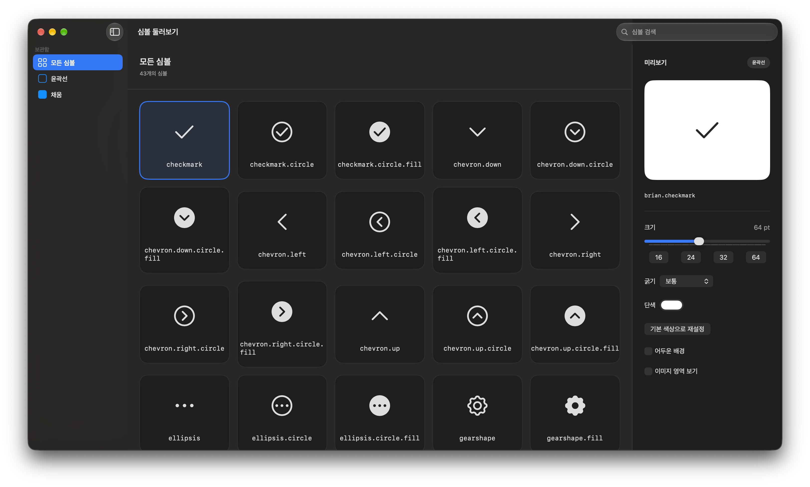

# Brian Symbols

[English](README.md) · **한국어**

커스텀 SF Symbol을 제공하는 Swift Package.
에셋과 공개 이름은 패키지에서 관리하며, 제공 항목과 개별 사양은 [에셋 목록](docs/symbol-assets.md)에서 확인할 수 있다.

## 설치

- iOS 16 이상 / macOS 13 이상
- 패키지 빌드에 Swift 6.4 이상 필요

```swift
.package(url: "https://github.com/thebriancompany/swift-brian-symbols.git", exact: "0.2.0")
```

**0.2.0**에서는 폴더 line·fill, 컬러 폴더, 문서 line·fill 심볼과 데모의 Color 그룹·렌더링 모드 설정을 제공한다.

## 사용 방법

```swift
import SwiftUI
import BrianSymbols

Image(brianSymbol: .house)
    .symbolRenderingMode(.monochrome)
    .foregroundStyle(.primary)
    .font(.system(size: 24, weight: .regular))
    .imageScale(.small)
    .frame(width: 24, height: 24)

Image(brianSymbol: .houseFill)
```

- `Image(brianSymbol:)`은 패키지의 리소스 번들에서 에셋을 찾는다.
- UIKit·AppKit에서 직접 불러올 때는 `BrianSymbol.resourceBundle`과 심볼의 `rawValue`를 사용한다.

컬러 심볼 사용법은 [컬러 폴더 예제](docs/symbol-authoring.md#using-the-color-folder)를 참고한다.

## 데모

데모 앱은 macOS 14 이상에서 실행할 수 있다.
[BrianSymbolsDemo.xcworkspace](Demo/BrianSymbolsDemo.xcworkspace)를 통해 확인 가능하다.

데모 조절 기능:

- Group에서 Line·Fill·Color를 선택한다. 컬러 에셋은 Color에 별도로 분류한다.
- 컬러 에셋의 Preview에서 Multicolor·Monochrome·Hierarchical·Palette를 선택한다. 기본 모드는 Multicolor다.
- Palette에서는 세 가지 색상을 각각 조절한다. 나머지 모드에서는 한 가지 색상을 조절하며, Multicolor의 고정 색상 영역은 유지된다.
- Reset to Default Color는 색상을 초기화하고 선택한 모드는 유지한다. Multicolor의 기본 틴트는 파랑이다.
- 크기·굵기·배경·이미지 경계 표시를 함께 조절할 수 있다. Preview에서 선택한 렌더링 모드와 팔레트는 목록 카드에 적용되지 않는다.



## 문서

README는 영어와 한국어로 제공하며, 나머지 문서는 영어로 제공합니다.

- [에셋 목록과 개별 사양](docs/symbol-assets.md)
- [형태와 이름 규칙](docs/symbol-naming.md)
- [심볼 제작·등록 가이드](docs/symbol-authoring.md)
- [에셋 PR 작성](docs/asset-pull-requests.md)
- [크기와 정렬 기준](docs/symbol-sizing.md)
