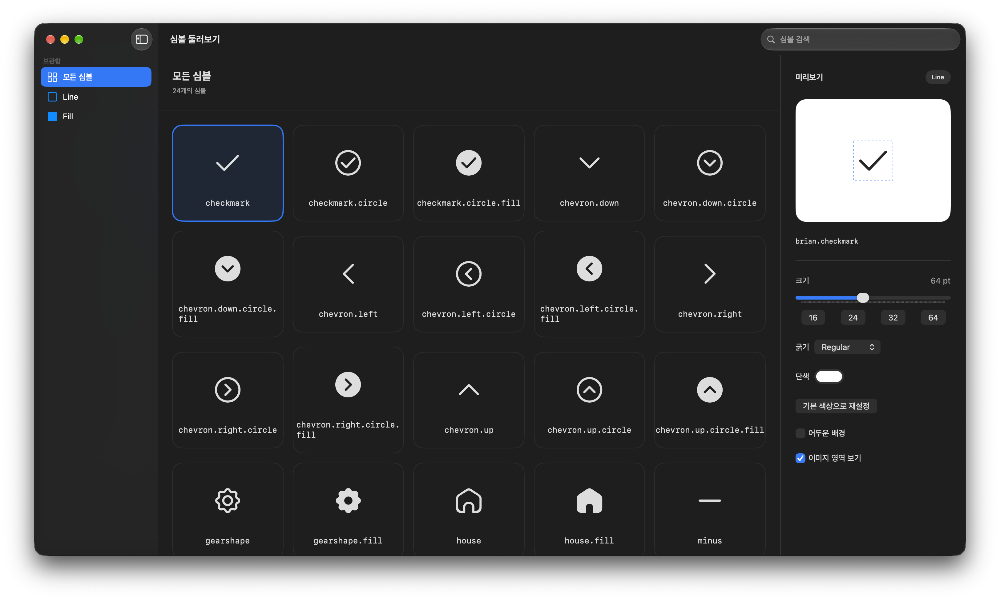

# Brian Symbols

커스텀 SF Symbol을 제공하는 Swift Package.
에셋과 공개 이름은 패키지에서 관리하며, 제공 항목과 개별 사양은 [에셋 목록](docs/symbol-assets.md)에서 확인할 수 있다.

## 설치
- iOS 16 이상 / macOS 13 이상

```swift
.package(url: "https://github.com/thebriancompany/swift-brian-symbols.git", branch: "main")
```


## 사용 방법

```swift
import SwiftUI
import BrianSymbols

Image(brianSymbol: .house)
    .symbolRenderingMode(.monochrome)
    .foregroundStyle(.primary)
    .font(.system(size: 24, weight: .regular))
    .imageScale(.small)
    .frame(width: 24, height: 24)

Image(brianSymbol: .houseFill)
```

- `Image(brianSymbol:)`은 패키지의 리소스 번들에서 에셋을 찾는다.
- UIKit·AppKit에서 직접 불러올 때는 `BrianSymbol.resourceBundle`과 심볼의 `rawValue`를 사용한다.


##  데모
 [BrianSymbolsDemo.xcworkspace](Demo/BrianSymbolsDemo.xcworkspace)를 통해 확인 가능하다.



## 문서

- [에셋 목록과 개별 사양](docs/symbol-assets.md)
- [형태와 이름 규칙](docs/symbol-naming.md)
- [심볼 제작·등록 가이드](docs/symbol-authoring.md)
- [크기와 정렬 기준](docs/symbol-sizing.md)
